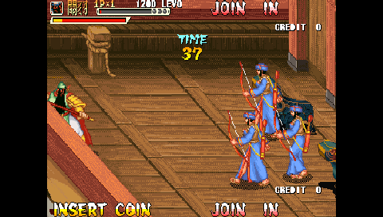
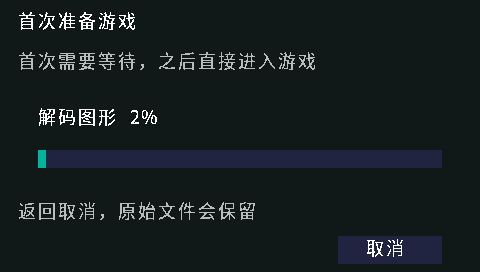
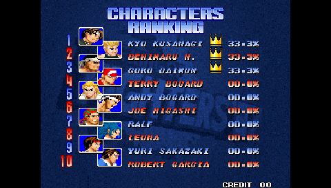
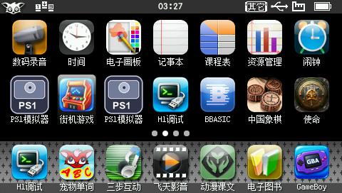
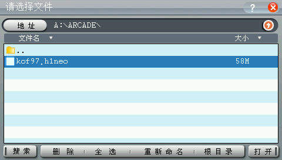
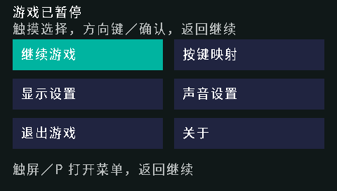
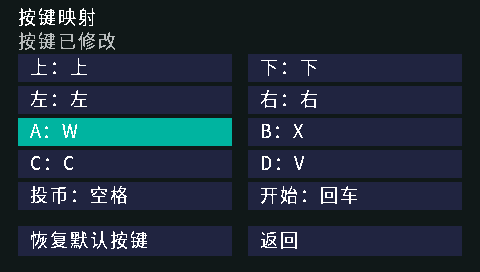
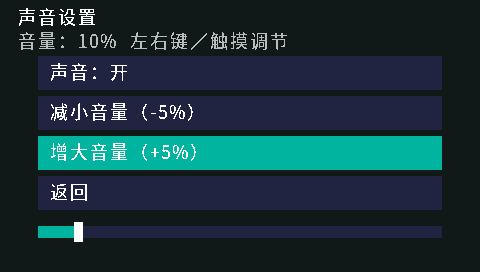
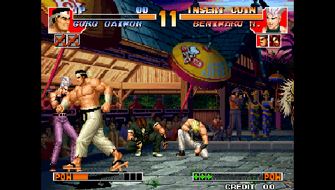

# 街机游戏 · BBKH1-Arcade

作者：**HelloClyde**。面向步步高 **H1 / Y100 V1.41、JZ4740、480×272 屏幕**的 **Neo Geo MVS / PGM 街机模拟器**，版本 **0.2.2**，开发预览。

公开 H1 移植层、A68K/MXU/HLE 优化、触屏菜单和 PC 转换工具，固定所有上游提交。
默认采用 **408 MHz、4:3 放大、固定跳1帧（目标约30显示帧/秒）、8 kHz 声音合成**。
完整组合保留第三方各自条款与非商业限制，见[许可说明](docs/licensing.md)。
[GitHub Releases 下载](https://github.com/HelloClyde/BBKH1-Arcade/releases)提供 BDA、安装包、完整对应源码及 SHA256 校验文件。

## 快速开始

下载 Release 的 **`H1Arcade-v0.2.2-install.zip`**，把“应用”和“ARCADE”目录复制到设备 A 盘根目录。
安装包已包含 `ARCADE/pgm.zip` 和 `ARCADE/neogeo.zip`，只需另放自己的游戏 ZIP。
也可以只下载 `H1Arcade.bda`，此时仍需自己配置对应 BIOS；本地构建输出为 `dist/H1Arcade.bda`。
通过 USB U 盘把它复制到设备 **`A:\应用\程序\H1Arcade.bda`**，刷新桌面后打开“**街机游戏**”。
游戏文件放在 **`A:\ARCADE\`**，直接选择原始游戏 ZIP，首次在 H1 上分块转换并显示进度，之后复用缓存：

| 系统 / 游戏 | 同目录需要的文件 | 设备生成的缓存 |
| --- | --- | --- |
| PGM《三国战纪》一代 `kov` V117 | 自己的 `kov.zip`、安装包已带的 `pgm.zip` | `.h1pgm`，约64.2 MiB |
| Neo Geo，例如《拳皇97》 | 自己的 `kof97.zip`、安装包已带的 `neogeo.zip` | `.h1neo`，拳皇97约58 MiB |

PGM 目前只支持 `kov` V117；其他版本、其他 PGM 游戏及 PGM2/PGM3 尚不支持。
PGM 缓存优先写在原 ZIP 旁，A 盘写入失败且临时文件清理成功时回退到 `B:\ARCADE`；之后仍选择原 ZIP 即可复用。
已有 `.h1neo` 也可直接打开，继续使用原来的存档与设置。详见[设备端转换说明](docs/device-import.md)和[PGM 说明](docs/pgm.md)。
游戏 ROM、H1 原机固件、转换缓存和个人存档不随安装包提供。
这两个 BIOS ZIP 由项目发布者提供并明确要求加入公开安装包，原样固定在 `assets/bios/`，供后续 CI 复现打包，逐成员清单和发布依据见 [BIOS 清单](assets/bios/manifest.json)。
BIOS 的版权与许可独立于 H1 代码的 GPL；本项目没有独立核实第三方版权授权，详情见[许可说明](docs/licensing.md)。

**v0.2.2 修复启动时长时间不出现文件选择器的问题**。v0.2.1 默认会在选择器前执行完整开发自检，真机排查确认这会占用几十秒；新版普通构建默认关闭这组自动检查，只有显式诊断构建才执行。安装包继续附带两个 BIOS。
新版 BDA 已改变，按用户要求本轮只安装、不启动验证；新版启动、PGM 与 Neo Geo 游戏回归均由用户后续验证，旧版性能数据不能作为新版实测结果。

Neo Geo 若希望在电脑上预先转换，安装包仍附带可选“PC工具”，包含 Windows x64 图形解码 DLL，只需 Python 3.12+，无需 GCC；
在该目录运行下列命令时，将 `tools/convert.py` 换成 `convert.py`。工具只处理本地提供的原始 ZIP：

```powershell
python -X utf8 tools/convert.py "你的/kof97.zip" --set kof97 --bios "你的/neogeo.zip" --output "你的/kof97.h1neo"
```

转换输出不会覆盖同名文件。完整参数以 `python -X utf8 tools/convert.py --help` 为准。
支持驱动：`kof94`、`kof95`、`kof96`、`kof97`、`mslug`、`mslug2`、`samsho`、`samsho2`、`samsho3`、`samsho4`、`lastblad`。
Neo Geo 的用户自备《拳皇97》在 v0.1.2 及更早版本完成真机功能验证；本次确切 BDA 未再次运行 Neo Geo 游戏回归，列出驱动不等于所有游戏已测通过。

**v0.2.0 将 PGM 加入默认发布构建**。该历史 BDA 的《三国战纪》V117 已用 H1Debug 真机确认投币、选人及玩家移动/攻击；408 MHz、4:3、跳1帧、8 kHz下，20.3秒实际战斗窗口达到 **60逻辑帧/秒、30显示帧/秒**。逐行合成后立即缩放输出，冻结帧完整绘图与输出由约22.14 ms降至14.32 ms。首次新资源加载仍会短暂掉速，不能保证所有关卡始终满速。这些数据仅对应 v0.2.0 的确切散列，不作为 v0.2.2 的游戏验证。详见[PGM 说明与原始真机记录](docs/pgm.md)。

| 操作 | 默认按键 |
| --- | --- |
| 方向 | 方向键 |
| 游戏动作 A / B / C / D | Z / X / C / V |
| 投币 / 开始 | 空格 / Enter |
| 打开暂停菜单 | 触摸屏幕 / P |
| 菜单操作 | 触摸，或方向键、确认、返回 |

暂停菜单提供继续游戏、10项按键映射、4:3／原尺寸／全屏显示、跳帧、音量、退出及关于。
设置按游戏保存在所用缓存旁的 `.cfg0` / `.cfg1`；Neo Geo NVRAM 为 `.nv0` / `.nv1`，均采用双槽与 CRC 校验。PGM 当前不保存 NVRAM。
408 MHz 在进入游戏后启用，正常退出时先停止声音并恢复原始时钟，再保存退出。
游戏中 ESC／返回也会直接退出；改映射时这些前端功能键保留。

### 开发者构建（Windows x64）

以下命令在仅含项目与固定子模块的检出中验证。需要 Python 3.12+、Git、x64 MinGW GCC；
MIPS 工具链由脚本安装，普通构建使用已生成的菜单字体，不需要下载字库。

```powershell
git clone --recurse-submodules https://github.com/HelloClyde/BBKH1-Arcade.git
cd BBKH1-Arcade
python -X utf8 -m pip install -r requirements.txt
python -X utf8 tools/install_toolchain.py
# 把你的 MSYS2 UCRT64 bin 加入 PATH，让 gcc 可用；也可通过 --host-cc 指定。
python -X utf8 tools/build_release.py
python -X utf8 tools/verify_release.py
```

Git 检出运行 `python -X utf8 tools/fetch.py` 初始化固定依赖。
完整源码 ZIP 已包含全部构建所需的固定源码快照，该命令仅验证快照，不下载上游。
若已安装工具链，可用 `--toolchain "你的工具链/bin" --host-cc "你的/gcc.exe"`，
或设置 `H1_GNU_BIN` 与 `HOST_CC`。脚本不依赖开发者用户名或本机 SDK 路径。
打包命令为 `python -X utf8 tools/package_release.py`，输出在 `dist/release/`；
版本标签由 CI 构建后生成同一套 BDA、安装包、完整源码、构建信息和校验文件。
安装包中的两个 BIOS ZIP 来自仓库内固定文件，打包时核对整包及成员清单，后续 CI 无需另行下载 BIOS。
默认 `tools/build_release.py` 已包含 PGM 和 Neo Geo；`tools/build_pgm.py` 保留为单独的 PGM 构建入口。

## 截图

以下均为 **H1Debug 采集的物理 H1、480×272 原尺寸截图**。
《三国战纪》玩家战斗图来自 **v0.2.0 历史 BDA**，与 v0.2.2 的 BDA 不同；本次没有运行新版采集截图：



以下为 v0.1.2 / v0.1.1 的历史界面与 Neo Geo 记录，不能据此宣称本版已重跑对应功能或所有场景满速。

| v0.1.2 设备端转换 | v0.1.2 游戏画面 |
| --- | --- |
|  |  |

| v0.1.1 桌面 | v0.1.1 游戏选择 |
| --- | --- |
|  |  |

| 历史版触屏暂停菜单 | 历史版按键映射 |
| --- | --- |
|  |  |

| 历史版音量设置 | 先前 408 MHz 版本的真机对战 |
| --- | --- |
|  |  |

## 验证范围

### v0.2.2 安装记录，用户真机验证待完成

本版确切 BDA 共 **1,240,380字节**，SHA256：`4663b6c25059c31b5a05820292d1fc6572235a2a965023200b09a24a2c34cae2`。
本次通过 H1Debug 安装到原应用路径，部署使用 `run=False`，没有运行新版、进入选择器或测试 PGM / Neo Geo 游戏。用户要求自行验证，当前记录不声明新版真机启动、原生自检、画面或性能通过。
详见[安装记录](docs/evidence/arcade-startup-installation-20261022.json)与[v0.2.2 发布关联记录](docs/evidence/v0.2.2-release-verification.json)。CI 的构建和文件检查不替代用户后续真机验证。

### 历史 PGM v0.2.0 / v0.2.1

v0.2.1 沿用 v0.2.0 的 BDA，共 **1,295,948字节**，SHA256：`0f3bfd95fe53f331308102a34a64be0218b39054871d73e2af1a72cbae39b2e0`。以下为这份历史 BDA 的既有真机测试，不是 v0.2.2 的测试。
该 BDA 已通过 H1Debug 在物理 H1 上运行用户自备的《三国战纪》V117，确认玩家投币、选人、移动与攻击、触屏暂停/继续及正常退出，退出恢复原336 MHz并释放输入。
408 MHz、4:3、跳1帧、8 kHz、音量10%下，20.325秒采样窗口为59.83/29.91逻辑/显示FPS，随后20.3秒关闭采样窗口为60/30 FPS；两个窗口均未回退到旧绘图路径。
新资源热身的10.175秒窗口为55.72/27.91 FPS，冷载入和新精灵解码仍可停顿。实时窗口不是确定性重放，也不保证所有关卡或长时超频始终满速。

同一冻结帧的旧完整绘图与LCD输出为22.14 ms，逐行合成及输出为14.32 ms；三种显示模式、稳定输出及UI覆盖后恢复均与独立参考整屏逐像素一致。
真实H1通过新增3,072项精灵MIPS/MXU、256项复制、512项背景MXU、各1,024项PGM访存/等待/分支等待、352项映射及2,048项Z80 HLE等原生检查；原有Neo Geo启动自检通过，但本轮没有再次运行Neo Geo游戏回归。
会话累计69次音频欠载、0次调用失败，包含启动、冷加载和全部调试，不能当作单个稳定窗口计数。
详见[v0.2.0 确切 BDA 真机记录](docs/evidence/pgm-stream-hardware-20261021.json)与[PGM 逐阶段数据](docs/pgm.md)。

### 历史 Neo Geo v0.1.2 / v0.1.1

以下记录对应各自旧 BDA，不作为 v0.2.0 / v0.2.1 / v0.2.2 的 Neo Geo 游戏回归证明。
v0.1.2 BDA SHA256：`1aab71d3d1537c5b3261ee9545e20440f8e919674cee01d3ba4bcf1ba2717692`。
已通过 H1Debug 在物理 H1 上从原始《拳皇97》ZIP 与 BIOS 完成首次转换，单独转换用时 **95.825秒**（3833个40 Hz原生tick），
不包含 USB 复制、启动自检、选择文件及后续载入。缓存大小60,555,520字节；全部区段CRC、精灵页CRC与使用表、176,384字节抽样均匹配PC参考。
已验证写入超过1 MiB后触屏及ESC取消、清理临时文件、保留原ZIP与旧缓存备份，重新选择ZIP复用缓存、沿用原设置和存档，
以及实际游戏、暂停菜单和正常退出恢复时钟。音量10%，4:3、跳1、8 kHz、4 MiB图形缓存均已核对。
v0.1.2约30秒混合游戏流程窗口为58.98逻辑FPS、29.48显示FPS；恢复运行后的音频日志累计1次欠载、0输出失败。
该窗口不是确定性对战回放，也不证明所有场景满速。详情见[v0.1.2历史真机记录](docs/evidence/hardware-verification.json)。

此前 v0.1.1 BDA SHA256：`3bf61408351efd4d9907490f1cba1ee8103bddf35ed7d0849ba51f3b5be55b35`。
该版本的独立仓库重建与真机 BDA 逐字节相同。
旧版真机验证包括桌面标题与图标、点击启动、**13,056 组启动差分自检**、原生文件选择和正常退出，
以及《拳皇97》的组合输入、触屏/键盘菜单、改键、三种显示、音量拖动、暂停冻结、继续、退出、时钟恢复、设置和 NVRAM 保存重开。
旧版三种显示模式在菜单恢复后与参考图比较均为0像素差异。

菜单版两段约30秒窗口为 **57.93 / 58.94 逻辑 FPS**、音频欠载5 / 1次；先前无菜单的 408 MHz 版本在另外的窗口达到约59.18逻辑 FPS。
这些是不同游戏时刻，不是确定性回放对照，也不证明所有场景稳定满速或长时超频稳定。
[旧版原始数值与构建关联](docs/evidence/v0.1.1-hardware-verification.json)保留历史构建的不同散列。

### CI 与主机测试

CI 只做实际 C 函数测试、构建、BDA校验及确切散列比对，**不运行真机或游戏 CPU／固件模拟器**。
可在本机运行：

```powershell
python -X utf8 tests/menu_host.py
python -X utf8 tests/import_host.py
python -X utf8 tests/present_host.py --optimize 3 --mxu
python -X utf8 tests/render_host.py --mxu-render
python -X utf8 tests/pgm_import_host.py
python -X utf8 tests/pgm_stream_host.py
python -X utf8 tests/pgm_scale_host.py
python -X utf8 tests/audio_fast_host.py --build release-a68k-idle-dirty-selftest-o3-lto-bus-reads-tiles-mxu-spritefix-drawmxu4-audio16-visible-speed-scale-cpu408-menu-pgm
```

普通构建默认直接进入文件选择器，不自动执行完整原生自检。诊断构建使用 `--cpu-selftest --startup-selftest`，
启动和 PGM 载入后才执行 CPU、MXU、绘图及音频检查；构建目录额外包含 `-startuptest`。
旧版 MXU 指令检查来自各自确切 BDA 的真机诊断记录；本次没有运行 v0.2.2 的诊断构建。主机测试中的标量替身仅验证 C 调度与像素运算。
手工 H1Debug 测试说明见 [docs/hardware-testing.md](docs/hardware-testing.md)。

## 依赖

| 依赖 | 固定提交 / 版本 | 用途 |
| --- | --- | --- |
| [H1 BDA SDK](https://github.com/MrDefinition1999/bbk-h1-bda-sdk) | `067fe072477861dfc8949d7b1a55279fb92d2548` | 原生 ABI、BDA 头与图标打包；`sdk/` 子模块 |
| [GnGeo / Apaczer](https://github.com/Apaczer/gngeo) | `6fa682e06b60df0ec42e99f00ffc196b52cfa780` | Neo Geo 图形、总线、Z80、YM2610 与驱动信息 |
| [fba-a320 / A68K](https://github.com/dmitrysmagin/fba-a320) | `68af7cc0065757c688595adc409f5d47977793ae` | MIPS32r1 68000、PGM布局/解密/ASIC28 HLE、ICS2115；原始声明见许可说明 |
| [Musashi](https://github.com/kstenerud/Musashi) | `313ebf1bd9f4d0d93341eb5ce21fd8a119e9dbdd` | 可选 C 68000 核心，构建生成器 |
| miniz 流式解压器 | Gnuboy `c367bb4ba96fb07cd62f72f5ecb43aeff7012564` 中的两份原文件 | 已随 `src/import_vendor/` 附带，MIT，供设备端读取 ZIP |
| GNU MIPS bare-metal | 15.2.0，安装包 SHA 固定在脚本 | 仅开发构建需要 |
| 原生 MinGW GCC、Git、Python | x64 GCC；Python 3.12+ | 仅开发构建与 PC 转换需要 |
| Pillow | 12.3.0 | 图标打包、测试和可选字体再生 |
| Noto Sans CJK SC | 固定来源和 SHA 见 [assets/README.md](assets/README.md) | 已生成中文字体子集，OFL-1.1 |

设备运行不需要 Python、GCC、SDL 或桌面版 GnGeo。上游只在 build 目录生成补丁副本，不修改子模块。
图标由内置 GPT 图像工具生成，透明 PNG、提示词与来源均在 `assets/`。

## 许可与感谢

H1 原创代码采用 **GPL-2.0-or-later 加独立模块链接例外**，见 [LICENSE](LICENSE)、[LICENSE-EXCEPTION](LICENSE-EXCEPTION)。
上游核心、SDK 和字体保留各自许可，完整组合不是统一 GPL，历史 MAME 组件包含非商业限制。
A68K 的原始作者声明与来源完整保留；H1 移植层的 GPL 不替代上游组件自己的条款，见 [docs/licensing.md](docs/licensing.md)。

感谢 Peponas Mathieu、Steward Fu、GnGeo / Apaczer 贡献者；A68K 的 Mike Coates、Darren Olafson、Manuel Geran、Dmitry Smagin；
Z80 的 Juergen Buchmueller，YM2610 的 Tatsuyuki Satoh、Jarek Burczynski 及 MAME 贡献者；
PGM 的 ElSemi、David Haywood、OopsWare 及 FBA 贡献者，ICS2115 的 O. Galibert、ElSemi、OopsWare；
Musashi 的 Karl Stenerud；H1 SDK 的 MrDefinition1999 及贡献者；Noto 字体贡献者。
感谢实际 H1 真机测试与问题反馈。完整来源声明见 [NOTICE.md](NOTICE.md)。
